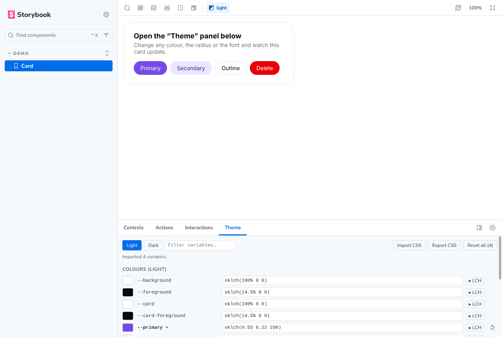

# storybook-addon-shadcn-theme-editor

[](https://www.npmjs.com/package/storybook-addon-shadcn-theme-editor)
[](https://github.com/ghudev/storybook-addon-shadcn-theme-editor/actions/workflows/ci.yml)
[](./LICENSE)

A live theme editor for [shadcn](https://ui.shadcn.com) themes, right inside Storybook.
Tweak the colours, radius and fonts of your real components in light and dark mode,
then copy the result back into your `app.css`.



- **Reads your theme automatically**: every `--variable` in your `:root { }` and `.dark { }` blocks.
- **Light and Dark** editing, each with its own values.
- **OKLCH-native**: popover colour picker with OKLCH, RGB and HSL channels – switch tabs to convert between them.
- **Import** a theme from [shadcn studio](https://shadcnstudio.com/theme-generator), tweakcn or any `:root` / `.dark` CSS.
- **Export** the finished theme as CSS, ready to paste into `app.css`.
- **Non-destructive**: changes live in your browser only, until you export them.
- **Framework-agnostic**: works with shadcn-svelte, shadcn/ui (React), shadcn-vue, or any CSS-variable theme.

## Requirements

- Storybook 10
- A theme defined as CSS custom properties in `:root` and `.dark`
  (the default for shadcn with Tailwind CSS v4)

## Install

```sh
npm install --save-dev storybook-addon-shadcn-theme-editor
```

Add it to `.storybook/main.ts`:

```ts
const config: StorybookConfig = {
  addons: [
    // …your other addons
    'storybook-addon-shadcn-theme-editor',
  ],
};
```

Make sure your global CSS is imported in `.storybook/preview.ts` (you probably do this already):

```ts
import '../src/app.css';
```

Restart Storybook and open the **Theme** tab in the addon panel.

### CSF Next (`definePreview`)

```ts
import { definePreview } from '@storybook/svelte-vite';
import shadcnThemeEditor from 'storybook-addon-shadcn-theme-editor';

export default definePreview({
  addons: [shadcnThemeEditor()],
});
```

### Light / dark switching

The **Light / Dark** tabs pick which set of values you are editing. To see dark mode in the
preview, toggle the `.dark` class, for example with
[`@storybook/addon-themes`](https://storybook.js.org/addons/@storybook/addon-themes):

```ts
import { withThemeByClassName } from '@storybook/addon-themes';

export const decorators = [
  withThemeByClassName({
    themes: { light: '', dark: 'dark' },
    defaultTheme: 'light',
  }),
];
```

## Usage

| Action                | How                                                                      |
| --------------------- | ------------------------------------------------------------------------ |
| Change a colour       | Click the swatch and pick in the field, or type any CSS colour           |
| Fine-tune / convert   | In the picker, choose **OKLCH**, **RGB** or **HSL** and use the sliders  |
| Change the radius     | Use the slider next to `--radius`                                        |
| Find a variable       | Type in **Filter variables…**                                            |
| Try a generated theme | **Import CSS** → paste the `:root` / `.dark` blocks → **Apply**          |
| Save your work        | **Export CSS** → **Copy to clipboard** → replace the blocks in `app.css` |
| Undo                  | ↺ next to a variable, or **Reset all**                                   |

Changed variables are shown in **bold** with a dot. Edits are saved in `localStorage`, so they
survive reloads and apply to every story until you reset them.

## How it works

The addon reads the custom properties declared in your `:root` and `.dark` rules (including rules
inside `@layer` and `@media`). Your edits are written to a `<style>` tag in the preview iframe with
slightly higher specificity, so they win over your stylesheet without touching it. When you change a
light value, the matching dark value is written too, so dark mode keeps working as before.

## Limitations

- Only `:root` and `.dark` selectors are detected. Themes that use other selectors
  (for example `[data-theme="dark"]`) are not picked up yet.
- Font variables (`--font-sans`, …) only take effect if your `@theme inline` block maps them
  and the font is loaded on the page.
- The picker's colour field works in sRGB. Colours outside sRGB are clipped there (the picker
  says so), but you can still type or slide to any OKLCH value. Converting such a colour to RGB
  or HSL clips it to sRGB.

## Contributing

See [CONTRIBUTING.md](./CONTRIBUTING.md). In short: `npm install`, then `npm run dev`.

## License

[MIT](./LICENSE)
